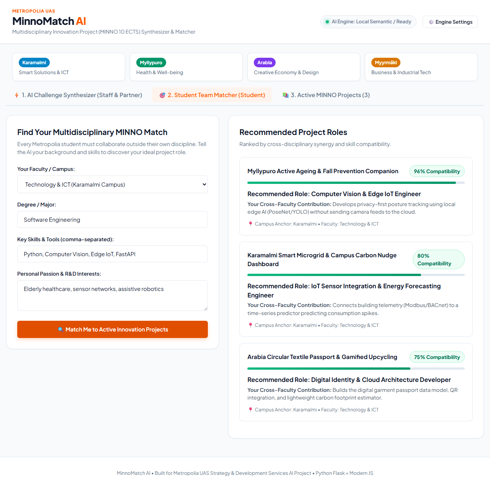

# MinnoMatch AI

An intelligent multidisciplinary project synthesizer and team matcher built for Metropolia University of Applied Sciences.

---

## Table of Contents

- [Overview](#overview)
- [The Problem at Metropolia](#the-problem-at-metropolia)
- [Key Features](#key-features)
- [Screenshots](#screenshots)
- [Architecture & Tech Stack](#architecture--tech-stack)
- [Getting Started](#getting-started)
- [API Reference](#api-reference)
- [Security & Quality Controls](#security--quality-controls)
- [Interview & Code Defense](#interview--code-defense)
- [License](#license)

---

## Overview

MinnoMatch AI is a full-stack Flask application designed for the Metropolia UAS Strategy and Development Services AI development initiative.

Every bachelor degree student at Metropolia must complete a mandatory 10-ECTS Multidisciplinary Innovation Project (MINNO). MinnoMatch AI leverages large language model orchestration and semantic heuristics to transform unstructured R&D challenges into structured, credit-bearing, cross-faculty project plans.

---

## The Problem at Metropolia

Metropolia UAS is Finland's largest university of applied sciences, with over 20,000 students across four distinct campuses:

| Campus | Faculty Focus | Key Challenge |
| :--- | :--- | :--- |
| **Karamalmi** | Smart Solutions & ICT | Technical focus often isolated from clinical and business needs |
| **Myllypuro** | Health Care & Social Services | Complex regulatory and clinical needs requiring tech implementation |
| **Arabia** | Creative Economy & Design | Service design and UX expertise looking for real-world projects |
| **Myyrmaki** | Business & Industrial Tech | Commercialization and viable business modeling |

### Current Bottlenecks:
1. **Campus Silos:** Students find it difficult to network and discover peers across different campuses.
2. **Ill-Defined Challenges:** External R&D partners submit vague problem statements that coordinators must spend hours decomposing manually.
3. **Lost Research Potential:** Projects produce useful prototypes but lack upfront academic framing to yield peer-reviewed publications.

---

## Key Features

- **AI Challenge Synthesizer (Staff & Partner Mode):**
  - Accepts raw, ill-defined partner problem statements.
  - Automatically decomposes challenges into four faculty work packages mapped to Metropolia campuses.
  - Identifies relevant UN Sustainable Development Goals (SDGs).
  - Outlines concrete academic research hypotheses and publication venues.
  - Generates a structured 12-week 10-ECTS Project Charter.

- **Student Team Matcher (Student Mode):**
  - Students enter their faculty, degree program, technical skills, and interests.
  - Computes cross-disciplinary compatibility scores (0-99%).
  - Generates tailored role descriptions highlighting each student's specific contribution.

- **Active Innovation Catalog:**
  - Searchable, campus-filterable repository of active MINNO projects.
  - One-click export of complete project charters in Markdown.

- **Dual-Mode AI Engine:**
  - **Offline Semantic Engine (Default):** Runs with zero configuration, no external API keys, and no costs.
  - **Live LLM Integration:** Supports Google Gemini (gemini-1.5-flash) and OpenAI (gpt-4o-mini) via API key settings.

---

## Screenshots

### 1. AI Challenge Synthesizer
Decomposes unstructured partner problems into campus-specific work packages, UN SDGs, and academic research targets.

### 2. Standard 10-ECTS Project Charter
Generates complete project documentation with 12-week sprint milestones and assessment rubrics.

### 3. Student Team Matcher
Calculates compatibility scores and highlights cross-faculty synergy for individual student profiles.

### 4. Active Projects Catalog
Enables filtering by campus location and multidisciplinary role allocations.

---

## Architecture & Tech Stack

### Tech Stack
- **Backend:** Python 3.11, Flask
- **Frontend:** Vanilla JavaScript (ES6+), HTML5, CSS3 (Metropolia Design System)
- **Persistence:** Atomic JSON storage with thread-safe file locking
- **AI / LLM:** Google Gemini REST API, OpenAI API, and local semantic knowledge engine
- **Testing & Tooling:** Python unittest, coverage, Playwright

### Repository Structure
`
d:\Flask|-- app.py                  # Flask routes, API endpoints, rate limiting, and security middleware
|-- ai_engine.py            # AI orchestration engine (heuristic + live LLM callers)
|-- test_app.py             # Unit and integration test suite
|-- capture_screenshots.py  # Playwright script for automated UI documentation
|-- requirements.txt        # Pinned dependency requirements
|-- .gitignore              # Environment and build exclusion rules
|-- data/
|   -- challenges.json     # Active MINNO project store
|-- templates/
|   -- index.html          # Web interface template
|-- static/
|   |-- style.css           # Styling and responsive design
|   -- app.js              # Client-side controller and DOM sanitization
-- screenshots/            # Application interface screenshots
`

---

## Getting Started

### Prerequisites
- Python 3.10 or higher
- pip package manager

### Installation

1. Clone the repository:
`ash
git clone https://github.com/<your-username>/<your-repo-name>.git
cd <your-repo-name>
`

2. Install dependencies:
`ash
pip install -r requirements.txt
`

3. Start the application:
`ash
python app.py
`

4. Open your browser and navigate to:
`
http://127.0.0.1:5000
`

---

## API Reference

| Method | Endpoint | Description | Auth Required |
| :--- | :--- | :--- | :--- |
| GET | / | Web interface | No |
| GET | /api/status | System health and AI provider status | No |
| GET | /api/challenges | Retrieve all active MINNO challenges | No |
| POST | /api/challenges | Create a new challenge | CSRF token |
| POST | /api/synthesize | Decompose an unstructured problem prompt | CSRF token |
| POST | /api/match-student | Match student profile against projects | CSRF token |
| POST | /api/export-charter | Generate Markdown project charter | CSRF token |
| POST | /api/settings | Configure AI provider and API keys | Admin token (optional) |

---

## Security & Quality Controls

The application is built with defensive engineering standards:

- **XSS Sanitization:** Server-side regex HTML stripping and client-side entity escaping (escapeHTML) on all dynamic content.
- **CSRF Defense:** Session-backed X-CSRF-Token required on state-changing POST requests.
- **HTTP Security Headers:** Strict Content-Security-Policy (CSP), X-Frame-Options: DENY, X-Content-Type-Options: nosniff, and Referrer-Policy.
- **Rate Limiting:** Sliding-window rate limiter per IP address to prevent request flooding and token exhaustion.
- **Input Boundaries:** 2MB maximum payload constraint; prompt lengths strictly validated (10 to 2,000 characters).
- **Atomic File Storage:** File locks (	hreading.Lock) combined with temporary file writes and atomic replacement (os.replace) to prevent concurrency corruption.

---

## Testing

Run the automated test suite:
`ash
python -m unittest test_app.py
`

Run test suite with statement coverage:
`ash
coverage run -m unittest test_app.py
coverage report -m
`

All 10 unit and integration tests validate:
- Defensive HTTP security headers
- Sensitive key suppression in status endpoints
- Input boundary enforcement (minimum and maximum string lengths)
- Type resilience (graceful handling of non-string and malformed inputs)
- Stored XSS tag stripping
- CSRF validation
- Concurrency-safe atomic persistence
- Mocked LLM API integration

---

## Interview & Code Defense

Key technical concepts for discussing this implementation:

### 1. Why Flask instead of Django or FastAPI?
Flask is lightweight, unopinionated, and minimal, making it ideal for microservices and prototyping. The AI orchestration layer (i_engine.py) is decoupled from the web framework, allowing the REST layer to be migrated to FastAPI or Quart if asynchronous streaming is required later.

### 2. Why a dual-mode AI engine?
In academic and public sector settings, third-party API availability, costs, rate limits, and student privacy (GDPR) are practical constraints. The dual-mode architecture guarantees zero-configuration offline execution for evaluation while allowing live LLM integration when credentials are supplied.

### 3. Perspective on vibe coding
Using LLMs to scaffold code accelerates prototyping velocity, especially when confronting ill-defined problems. However, raw generated code often carries hidden flaws: missing input validation, unhandled exceptions, and security oversights. Professional engineering uses AI for rapid exploration, while rigorously applying architecture patterns, defensive validation, test coverage, and security hardening.

---

## License

This project was developed for the Metropolia University of Applied Sciences AI Project (Strategy and Development Services).
Distributed under the MIT License.
# MinnoMatch-AI

# MinnoMatch-AI

