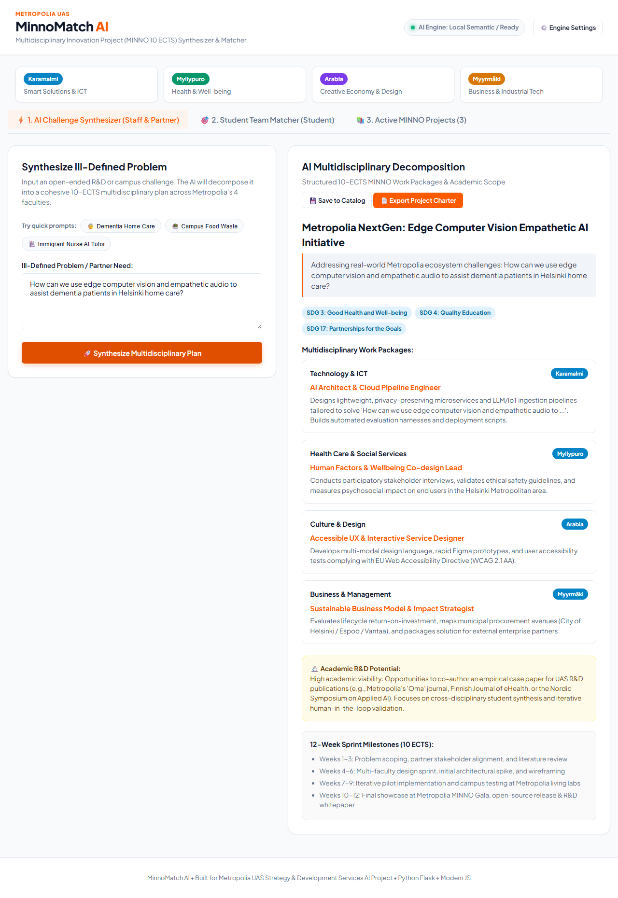
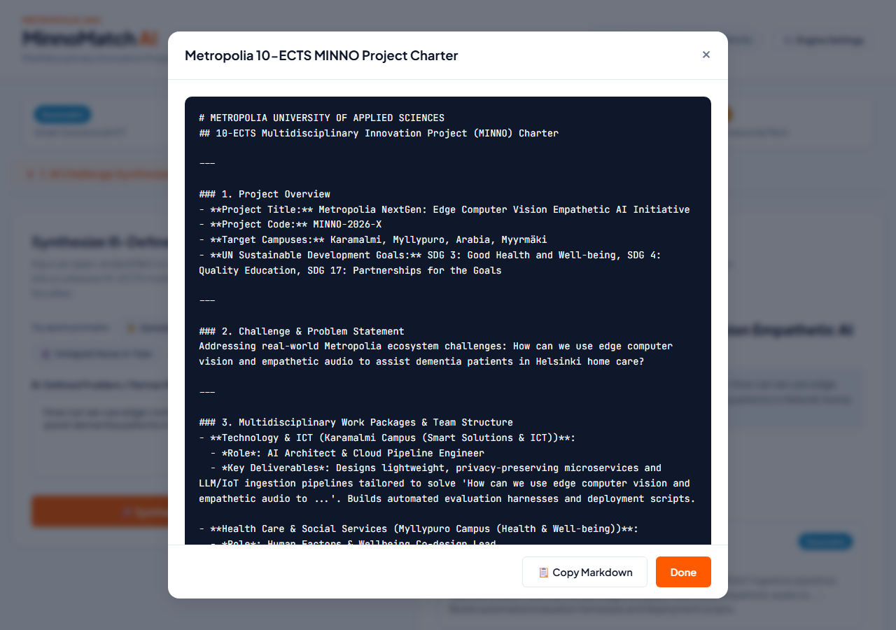
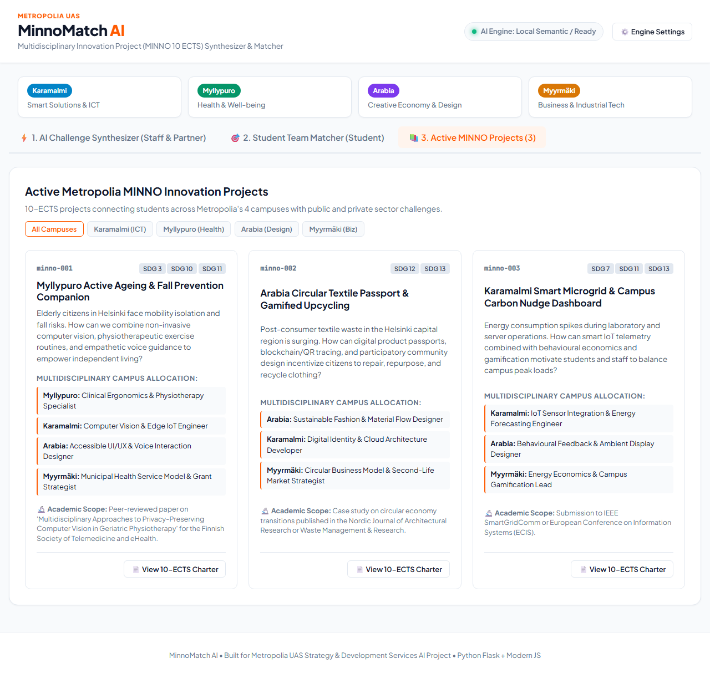

# MinnoMatch AI 🎓🤖
### Metropolia UAS Multidisciplinary Innovation Project (MINNO 10 ECTS) Synthesizer & Matcher

> **Built for the Metropolia UAS Strategy & Development Services AI Project Application**  
> *Showcasing an AI solution to a real challenge at Metropolia University of Applied Sciences.*

---

## 📌 Problem Background: Metropolia's MINNO Challenge

At **Metropolia University of Applied Sciences** (Finland’s largest UAS with >20,000 students and 1,200 staff), every bachelor’s degree student is required to complete a **10-ECTS Multidisciplinary Innovation Project (MINNO)**.

### The Real-World Pain Points:
1. **Campus & Faculty Silos:** Metropolia operates across 4 specialized campuses:
   - 💻 **Karamalmi Campus:** Smart Solutions & ICT / Technology
   - 🏥 **Myllypuro Campus:** Health Care & Social Services
   - 🎨 **Arabia Campus:** Creative Economy, Media & Design
   - 📈 **Myyrmäki Campus:** Business & Industrial Technology
   Students and faculty find it difficult to identify and form cross-faculty teams where tech, health, design, and business genuinely intersect.
2. **Ill-Defined Partner Challenges:** External R&D partners (hospitals, cities like Helsinki/Espoo/Vantaa, startups) submit unstructured, open problems (e.g. *"prevent elderly falls"* or *"reduce campus food waste"*). Academic staff spend dozens of hours manually decomposing these into distinct, credit-bearing student roles.
3. **Academic & R&D Publication Potential Lost:** Student MINNO projects frequently produce innovative discoveries, but lack an upfront research framework to translate findings into peer-reviewed conference papers or UAS articles.

---

## 💡 The AI Solution: MinnoMatch AI

**MinnoMatch AI** is a lightweight, responsive Flask web application that acts as an intelligent R&D facilitator for Metropolia:

1. **AI Challenge Synthesizer (Staff & Partner Mode):**
   - Takes an ill-defined, open-ended problem statement.
   - Decomposes it into 4 faculty-specific work packages mapped directly to Metropolia campuses.
   - Tags relevant **UN Sustainable Development Goals (SDGs)** and formulates a **peer-reviewed academic publication angle**.
   - Generates an exportable **10-ECTS Project Charter** with 12-week sprint milestones and assessment rubrics.

2. **Student & Team Matcher (Student Mode):**
   - Students input their faculty, degree, technical skills, and personal interests.
   - The AI calculates a compatibility percentage against active R&D challenges and synthesizes their exact cross-faculty contribution.

3. **Active Project Catalog & Charter Generator:**
   - Centralized repository of Metropolia MINNO projects filterable by campus.
   - Instant export of official project charters in Markdown for course administration.

---

## 📸 Screenshots

### 1. AI Challenge Synthesizer (Staff / Partner Decomposition)


### 2. 10-ECTS Metropolia Project Charter Export


### 3. Student Team & Role Matcher


### 4. Active Innovation Projects Catalog (Campus Filtered)


---

## 🏗️ System Architecture & Code Design

```
d:\Flask\
├── app.py                     # Flask web server, route definitions, REST API endpoints
├── ai_engine.py               # Dual-mode AI orchestration (Semantic Graph + Live LLM API)
├── test_app.py                # Unit & integration test suite (Flask test client)
├── capture_screenshots.py     # Automated Playwright test & screenshot generation
├── requirements.txt           # Python dependency specifications
├── .gitignore                 # Standard Python git exclusions
├── data/
│   └── challenges.json        # Pre-seeded Metropolia R&D innovation projects
├── templates/
│   └── index.html             # Clean, responsive HTML5 layout with Metropolia branding
├── static/
│   ├── style.css              # Custom Nordic modern CSS design system
│   └── app.js                 # Dynamic UI controller (fetch API, tabs, modals, filters)
└── screenshots/               # Automated visual repository evidence
```

### Dual-Engine Design:
- **Offline Semantic Knowledge Graph (Default):** Runs 100% offline with zero external API keys or quota limits. Uses rule-based heuristics and Metropolia pedagogical templates to reliably decompose problems.
- **Live LLM Integration (Gemini / OpenAI):** Users can enter an API key or set environment variables (`GEMINI_API_KEY` or `OPENAI_API_KEY`) in the UI Settings modal to trigger real-time generative decomposition.

---

## 🚀 Quickstart Guide

### 1. Prerequisites
- Python 3.10+ installed
- Pip package manager

### 2. Install Dependencies
```bash
pip install -r requirements.txt
```

### 3. Run the Flask Server
```bash
python app.py
```
Open your browser and navigate to: **`http://127.0.0.1:5000`**

### 4. Run Test Suite
```bash
python test_app.py
```
*Expected: 5 passed unit and integration tests in <0.05s.*

---

## 🎯 Interview Preparation: Code & Architectural Defense

The job description states:
> *"You can vibe code the app, but we will ask some questions about the code if you are selected for an interview. In this task, we assess your creativity and ability to come up with your own solutions to ill-defined problems."*

Here are the key technical concepts and rationale behind every design decision:

### Q1: Why Flask instead of a larger framework like Django or FastAPI?
> **Answer:** Flask is minimalist, unopinionated, and lightweight. For rapid R&D prototyping and microservices, Flask provides immediate control over routing, JSON serialization, and Jinja templating without the overhead of Django’s ORM and admin site. If this project scales to high-concurrency async LLM streaming, we can migrate the REST layer to FastAPI or Quart with minimal refactoring since `ai_engine.py` is completely decoupled from the web framework.

### Q2: How does the AI decompose ill-defined problems into multidisciplinary roles?
> **Answer:** We use a structured JSON schema prompt that grounds the model in Metropolia’s specific organizational structure (4 faculties, 4 campuses). By asking the model for domain classification, UN SDGs, and discrete work packages with clear deliverables, we prevent generic "AI chat" responses and enforce concrete, actionable team roles suitable for a 10-ECTS curriculum.

### Q3: Why implement a dual-mode engine (offline heuristics + live LLM)?
> **Answer:** In academic and R&D environments, external API availability, cost, rate limits, and student privacy (GDPR) are critical constraints. The offline engine guarantees reproducibility, zero downtime, and instant responsiveness during demos or evaluations, while the live LLM integration demonstrates prompt engineering and external API orchestration.

### Q4: What is your take on "Vibe Coding"?
> **Answer:** Vibe coding (using LLMs for rapid ideation and scaffolding) is an extraordinary tool for increasing developer velocity and prototyping solutions to ill-defined problems. However, **vibe coding without architectural understanding is a liability**. True engineering requires:
> 1. Verifying security, data validation, and input sanitization.
> 2. Decoupling business logic from framework code so components can be tested and swapped.
> 3. Designing robust fallbacks for when LLMs hallucinate or fail.
> In this assignment, vibe coding accelerated initial UI and CSS scaffolding, but code structure, test suites, API design, and domain mapping were intentionally engineered for maintainability.

---

## 📄 License & Attribution
Developed for the Metropolia UAS AI Development Project (Strategy & Development Services).
Open-source under the MIT License.
